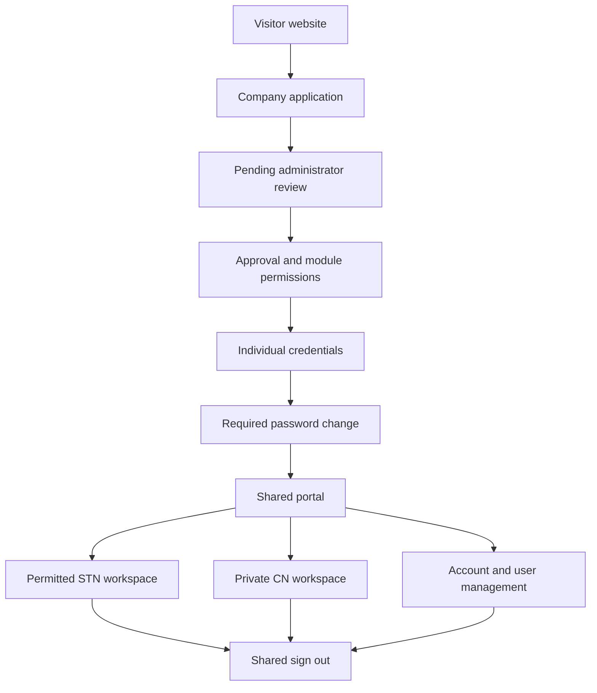

# Combined STN + All Crop CN audit — 28 October 2026

This cumulative release starts from the clean-profile repository source. Four agents reviewed public registration, authentication, STN and CN, with a coordinated production-build/local-gateway journey. No GitHub repository, deployment, live database or original Meet-Dev code was changed.

## Application structure and flow

The local Python gateway serves the shared identity/account system and CN application, and forwards STN/public requests to Next.js. STN uses MongoDB. CN and shared account persistence use the configured private local data directory. This is the local installation architecture, not a certified internet production architecture.

CN workflow: create an empty workbook → import supported statement → map products/packing → configure and confirm schemes → allocate receipts and resolve review items → calculate → finalise/issue → report/export. Existing workbooks retain their saved settings, source evidence and frozen results. STN workflow includes seller reports and review, temporary/permanent case history, and seed request → quotation → selection/contact exchange → closure/history. Company and individual permissions govern access throughout.

## Confirmed defects fixed

1. STN shared navigation previously redirected to login even after a failed logout. It now checks session/logout responses, prevents repeated clicks, shows retryable errors and navigates only on successful logout or an expired session. Dark-theme navigation contrast is improved.
2. Shared portal now clears signed-in controls after a 401 and prevents duplicate logout requests, avoiding an expired-session dead end.
3. Public Home navigation could enter the shared portal because Next client routing canonicalised the visitor root to `/`. Home/brand links now use full-document navigation through `/home`, which sends anonymous visitors to `/stn`; member/admin routing is preserved. About, Contact, FAQ, legal pages, public header, legacy navigation and registration success are covered.
4. Malformed or oversized registration bodies now receive appropriate 400/413 responses instead of a generic 500.

Test-only repairs handle cross-realm SyntaxError assertions, hidden review disclosures, permitted rendering additions, and Chromium context/font setup. These do not change financial calculations.

## Verification

See the current `verification/four_agent*` and `verification/full_audit*` records and the four individual audit reports. Other verification files are historical evidence for earlier releases, not newly executed checks.

- Full combined gateway/browser journey passed, including both-theme public navigation, real registration → approval → forced password change, STN trading/case history, CN ₹38,561 fixture, exports, ownership, module revocation, service restart and shared logout.
- 24 portal tests, 8 authentication browser scenarios, 12 registration tests and 12 STN tests passed.
- 59 combined CN tests passed; original financial suite: 331 passed, 1 skipped.
- Clean-profile and billing/offline browser checks passed; all 140 protected baseline files match; five private-statement acceptance tests passed.
- These recorded checks used the local launcher. Production deployment is still pending.

## Limits and deferred work

- This audit covers the recorded journeys and failure cases; it does not prove every possible input, screen combination, concurrency scenario or security attack is defect-free.
- Native Windows acceptance remains pending until the owner tests this release.
- Internet hosting remains pending. `integration/run_local.py` deliberately restricts the database/interface to local use; Hostinger production configuration, hosted MongoDB, HTTPS, secrets, backups/recovery, monitoring and deployment/rollback need separate implementation and verification.
- Runtime used available MongoDB 8.2.6 for disposable testing; the Windows launcher requests 7.0.24. This run does not verify that Windows/database-version combination.
- Unknown packet-weight schemes remain deferred. Do not enter dummy weights; current mapping requires positive packing weight, even for a proposed per-packet scheme.
- Email delivery and external integrations were not certified against live services. Synthetic fixtures were used for account/STN journeys. Private statement fixtures remain outside release archives.

## Use the release

The repository ZIP contains `stn-cn-portal/`; upload its contents to the new private repository. The Windows ZIP contains the same cumulative source with Windows setup/start scripts at its root. Read `START_HERE_WINDOWS.md`. Dependencies are installed by setup; these are not standalone compiled executables or upload-and-run production bundles.

For an existing installation, stop all services and back up the complete `integration-data` directory, including its keys. Extract code into a separate folder and preserve the complete data directory and existing credentials. Do not erase data or initialise over it. Test login, member/admin permissions, saved workbooks, a calculation, sign-out and restart before replacing the accepted copy. Fresh profiles start empty; this release does not wipe existing profiles.

Both archives include `AUDIT_PACKAGE_SHA256.json` with file hashes. No live credentials, private keys, databases, user uploads, private statement PDFs, node_modules, browser binaries or screenshots are included.
